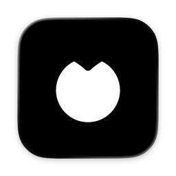

<p align="center">
  
</p>

<h1 align="center">OpenVocally</h1>

<p align="center">Push-to-talk dictation for macOS that transcribes on your Mac.</p>

<p align="center">
  <a href="https://github.com/MateuszRomek/openvocally/releases/latest"></a>
  
  
  <a href="LICENSE"></a>
  <a href="https://github.com/MateuszRomek/openvocally/actions/workflows/ci.yml"></a>
</p>

<p align="center">
  <a href="https://github.com/MateuszRomek/openvocally/releases/latest/download/OpenVocally.dmg"><b>Download OpenVocally for macOS</b></a>
  &nbsp;·&nbsp;
  <a href="https://openvocally.com">openvocally.com</a>
</p>

<!-- Demo GIF goes here. -->

Hold a shortcut, speak and release. OpenVocally transcribes your speech on your Mac and pastes the text into the app you are using. Your audio never leaves the Mac.

## Features

- **Push to talk or toggle.** Hold ⌥Space to dictate, or press ⌥D to start and again to stop. Escape cancels. Any shortcut can be a key chord. Push to talk can also be a single held key, and toggle a double tap of a modifier.
- **Local speech models.** Choose Parakeet v3, Parakeet Ultra or Whisper Turbo. The Parakeet models detect the language on their own across 25 languages and add punctuation and capitals.
- **Pastes where you type.** The text lands in the frontmost app, and your clipboard is restored afterwards. ⌃⌥V pastes the last transcript again.
- **A small recording indicator.** The overlay sits in the notch, or floats as an island at the top or bottom of the screen.
- **History and stats.** Transcripts keeps every dictation, so you can copy or delete one later. Home shows your word counts, activity over time and the apps you dictate into most. You can delete transcripts automatically after 7, 30 or 90 days.
- **A native Mac app.** It is written in Swift and SwiftUI, with light and dark appearance, a menu bar item you can hide, and sound cues you can turn off.

## Privacy

Dictation runs fully on your Mac. OpenVocally goes online for two things:

- To download a speech model from Hugging Face when you pick one.
- To check for updates, in release builds. You can turn automatic checks and automatic installs off in **Settings > Updates**.

The app has no account and no analytics. It keeps your transcripts in a local database until you delete them. [SECURITY.md](SECURITY.md) describes how the app handles the microphone, Accessibility, the clipboard and the network. The [privacy policy](https://openvocally.com/privacy) is on the website.

## Requirements

- A Mac with Apple Silicon
- macOS 15 or newer
- Microphone access, to hear you
- Accessibility access, for the shortcuts and to paste into other apps

## Install

Download [OpenVocally.dmg](https://github.com/MateuszRomek/openvocally/releases/latest/download/OpenVocally.dmg), open it and drag OpenVocally to Applications. The app is signed with a Developer ID and notarized by Apple. On first launch, a short setup asks for the permissions, sets up the shortcut and the overlay, and downloads a speech model.

Release builds update themselves with [Sparkle](https://sparkle-project.org). Each update is signed, and the app checks the signature before it installs.

## Build from source

You need Xcode 27 or newer, XcodeGen (`brew install xcodegen`) and the Xcode Metal Toolchain (`xcodebuild -downloadComponent MetalToolchain`). Then run:

```sh
scripts/setup-signing.sh   # once, so macOS keeps the permissions across rebuilds
make install               # builds a Release app, installs it in /Applications and opens it
```

Builds from source have no updater. [CONTRIBUTING.md](CONTRIBUTING.md) lists the main `make` targets and the code rules, and [docs/architecture.md](docs/architecture.md) explains how the code fits together. CI runs `make check` on every pull request and every push to `main`.

## Contributing

Bug reports, feature requests and documentation fixes are welcome as [issues](https://github.com/MateuszRomek/openvocally/issues). OpenVocally does not accept pull requests for now, but you are welcome to fork it under the license. See [CONTRIBUTING.md](CONTRIBUTING.md).

## License

Copyright (C) 2026 Mateusz Romek and OpenVocally contributors.

OpenVocally is free software under the GNU General Public License, version 3 only (GPL-3.0-only). See [LICENSE](LICENSE).

Third-party components keep their own licenses. The About window lists them, and the app ships their full texts in `Contents/Resources/Licenses`.
